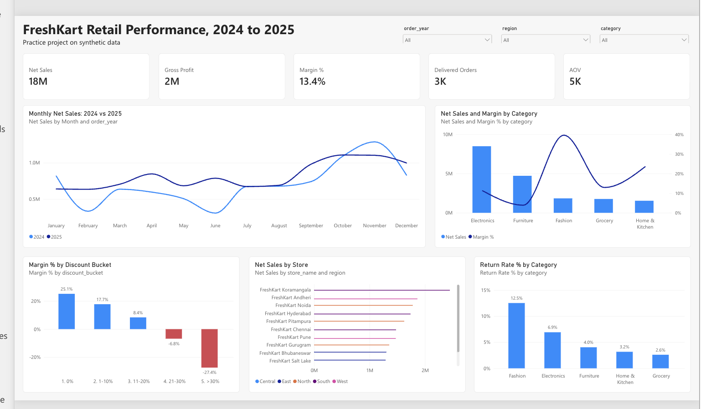

# FreshKart Retail Analysis: SQL Data Cleaning, Business Analysis and Power BI Dashboard

> **Practice project on a synthetic dataset.** FreshKart is a fictional 12-store Indian retail chain. The data was generated for practice, with data quality problems deliberately included. No real company or customer data is used.



## The business problem

FreshKart's category head wanted to know three things:

1. How did the business perform in 2024 and 2025?
2. Where is profit leaking?
3. What should the team change first?

Before any of that could be answered, the raw data had to be checked and cleaned.

## Data

| Table | Raw rows | Description |
|---|---|---|
| `orders` | 5,511 | One row per order line, January 2024 to December 2025 |
| `customers` | 2,025 | Customer master |
| `products` | 48 | Product master with selling and cost prices |
| `stores` | 12 | Store master across 5 regions |

Client business rules: `sales_amount` comes from the POS system and is the trusted value; net sales count only `Delivered` lines; profit = sales − (quantity × cost price).

## Approach

**1. Data profiling (`sql/01_profiling.sql`)**
Loaded all CSVs into PostgreSQL (Supabase) as text-only staging tables so no row was dropped on import. Checked row counts, duplicates, nulls, distinct values, formats (regex), value ranges and referential integrity between tables.

**2. Data quality log (`docs/dq_log.csv`)**
Found and logged **23 data quality issues** across three tables, each with rows affected, how it was found, the fix, the DQ dimension (completeness, uniqueness, validity, consistency, accuracy, integrity) and the assumption made.

| Table | Issues | Examples |
|---|---|---|
| Products | 3 | Duplicate product row, missing cost price, inconsistent category case |
| Customers | 7 | 25 duplicate rows, 4 date formats, city name variants (Bangalore/Bengaluru, Gurgaon/Gurugram) |
| Orders | 13 | 42 duplicate rows, 1,664 non-standard dates, discounts stored as "15%", sales as "₹1,234.00", negative and outlier quantities, 114 lowercase product IDs |

**3. Cleaning (`sql/02_cleaning.sql`)**
Built re-runnable clean tables with CTEs (dedup → parse → business rules). Unknown customers and invalid ship dates were flagged, not deleted, so no sales were lost. Validation confirmed 5,469 clean lines, zero unparsed dates, zero invalid quantities and **zero mismatches** between quantity × price × (1 − discount) and sales amount.

**4. Business analysis (`sql/03_analysis.sql`)**
Answered 10 business questions using joins, `CASE`, `FILTER`, CTEs and window functions (`RANK`, `LAG`, running `SUM`).

**5. Dashboard (Power BI)**
One-page dashboard with DAX measures (Net Sales, Gross Profit, Margin %, Delivered Orders, AOV, Return Rate %), monthly trend, category, discount, store and return views, and year, region and category slicers.

## Key insights

| Metric | Result |
|---|---|
| Net sales | ₹85.1 lakh (2024) → ₹98.6 lakh (2025), **+15.8% YoY** |
| Gross margin | 13.4% overall |
| Discounts above 20% | **Loss-making**: −6.8% margin (21–30%), −27.4% (above 30%); combined loss of ₹3.57 lakh |
| Furniture | 73% of all sales discounted above 20%; category margin only 3.9% (Fashion: 39.6%) |
| Cash on Delivery | 17.7% order cancellation rate vs 4.4% for UPI |
| Fashion returns | 12.5% return rate, highest of all categories |
| Seasonality | October and November contribute 25% of annual sales |

## Recommendations

1. **Cap discounts at 20%, starting with Furniture**, with an approval step for anything higher. Restoring Furniture's discounted sales to its normal 16% margin could recover an estimated ₹5–8 lakh of gross profit over two years (estimate, assuming similar volumes).
2. **Reduce Cash on Delivery cancellations** with prepaid incentives (for example UPI cashback) and confirmation messages for high-value COD orders, tracked monthly against a target below 10%.

Full write-up: [`docs/insights.md`](docs/insights.md)

## Repository structure

```
freshkart-retail-analysis/
├── README.md
├── data/                  raw CSV files (with deliberate data quality issues)
├── sql/
│   ├── 01_profiling.sql   data profiling queries
│   ├── 02_cleaning.sql    re-runnable cleaning script + reporting view + validation
│   └── 03_analysis.sql    10 business questions
└── docs/
    ├── dq_log.csv         23 logged data quality issues
    ├── insights.md        insights and recommendations
    ├── dashboard.png      dashboard screenshot
    └── dashboard.pdf      dashboard export
```

## How to reproduce

1. Create a PostgreSQL database (for example, a free Supabase project).
2. Load each CSV from `data/` into a table named `<file>_raw` with all columns as `text`.
3. Run `sql/01_profiling.sql`, then `sql/02_cleaning.sql`, then `sql/03_analysis.sql`.

## Tools

PostgreSQL (Supabase) · SQL (CTEs, window functions, regex) · Power BI (DAX) · Excel/Google Sheets (DQ log)

## Author

Abhishek Srivastava · [LinkedIn](https://www.linkedin.com/in/abhishek-srivastava-52444b197)
